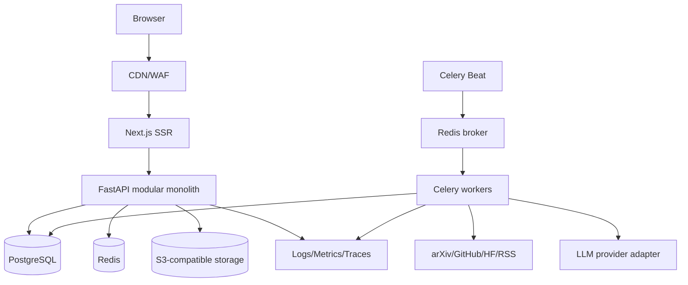

# 02 — System Architecture

## Logical architecture

## Backend modules
- `identity`: OIDC JWT validation, user provisioning, RBAC.
- `content`: canonical resources, source links, status lifecycle.
- `papers`, `repositories`, `news`: specialized metadata and validation.
- `taxonomy`: controlled dimensions, aliases, classification assignments.
- `search`: lexical retrieval, facets, ranking, pagination.
- `submissions`: contributor workflow.
- `moderation`: review queue, audit, appeals (later).
- `ingestion`: connectors, checkpoints, normalization, dedupe, enrichment.
- `admin`: source health and moderation operations.

## Domain events
`ContentCandidateDiscovered`, `ContentNormalized`, `ContentPublished`, `ContentRejected`, `TaxonomyAssigned`, `SubmissionCreated`. MVP events may be internal service calls plus transactional outbox for async side effects; do not pretend in-memory callbacks are durable. Worker tasks must be idempotent.

## Authentication
Choose one OIDC provider (e.g., managed provider) before production. Next.js manages browser session; FastAPI validates bearer token issuer/audience/signature via JWKS. Map stable subject to local `users.auth_subject`. Require role checks in API. CSRF protection for cookie-authenticated mutations; no tokens in localStorage.

## Deployment topology
Separate web, API, worker, beat. Managed PostgreSQL with PITR where available, managed Redis, object storage. One staging and one production environment. Health: `/health/live`, `/health/ready`; readiness checks database and required dependencies with bounded timeouts.

## Scaling
Start with PostgreSQL FTS, optional `pg_trgm`, then pgvector only after relevance evaluation. API and worker scale separately; queues `fetch`, `enrich`, `index`, `notifications`. Add external search infrastructure only after measured bottlenecks. Cache feed responses with explicit invalidation on publish/unpublish.

## ADRs to create
ADR-001 stack; ADR-002 auth; ADR-003 canonical content and provenance; ADR-004 search; ADR-005 publishing policy; ADR-006 ingestion job idempotency; ADR-007 hosting and data residency.
